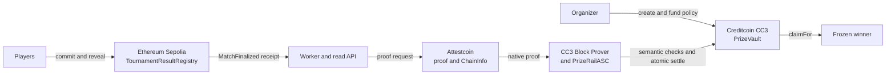

# PrizeRail

**Proof-bound tournament prize escrow for on-chain game results.**

PrizeRail takes a result recorded by a game on Ethereum Sepolia, proves that exact successful transaction and its canonical history through Attestcoin, and releases a prefunded Creditcoin CC3 prize only to the winner encoded in the verified event.

Tournament results and prize reserves often live on different chains. PrizeRail makes that settlement boundary explicit, policy-bound, and inspectable. The source game determines the result. PrizeRail settles it. It does not claim to prove off-chain gameplay fairness or detect cheating.

[Live app](https://prizerail.vercel.app) | [Current-code evidence](evidence/worker-live-v2-2026-09-12T22-53-43-237Z-2056792-055a2cae90a0.json) | [How it works](#how-it-works) | [Architecture notes](research/IMPLEMENTED-ARCHITECTURE.md) | [Verify it yourself](#verify-it-yourself) | [Public API](https://briefing-issue-appliance-rover.trycloudflare.com/api/v1) | Demo video: pending

> One recorded result -> one proof -> one frozen winner -> one claim.

## Judge PrizeRail in 3 minutes

1. Open the [current-code live evidence bundle](evidence/worker-live-v2-2026-09-12T22-53-43-237Z-2056792-055a2cae90a0.json). It contains the source receipt, decoded winner and rules, Attestcoin proof metadata, CC3 settlement, payout, restart evidence, and a mined replay rejection.
2. Open the public explorer links in the bundle, or use the direct links in [Live proof](#live-proof).
3. Run the read-only verifier. It needs no private key and sends no transaction:

```bash
npm run verify:demo -- evidence/worker-live-v2-2026-09-12T22-53-43-237Z-2056792-055a2cae90a0.json
```

   The recorded v2 run verifies as `PASS` when the public RPCs are available. The verifier reports infrastructure uncertainty as `UNKNOWN` instead of treating it as business success or failure.
4. Inspect [expired-policy recovery](evidence/recovery-f620cf7d.json) and run its read-only check:

   ```bash
   npm run verify:recovery -- evidence/recovery-f620cf7d.json
   ```

The public frontend is available at [prizerail.vercel.app](https://prizerail.vercel.app). The read-only API is currently reachable at [briefing-issue-appliance-rover.trycloudflare.com/api/v1](https://briefing-issue-appliance-rover.trycloudflare.com/api/v1), temporarily exposed through a Cloudflare Quick Tunnel to the live WSL-hosted API, with its worker running alongside it. This session-based tunnel is a temporary demo access path, not production infrastructure. The YouTube demo remains pending; the evidence bundles and no-key verifier are still the reproducible judge path.

## What is built

- A deterministic commit/reveal Rock-Paper-Scissors source registry on Ethereum Sepolia. It emits a project-owned `MatchFinalized` event with the tournament, winner, rules hash, result nonce, source chain ID, and finalization status.
- An immutable-policy `PrizeVault` on Creditcoin CC3. It holds the prefunded test-token reserve and owns the `DRAFT -> FUNDED -> CLAIMABLE -> CLAIMED` state machine, plus refund and expired recovery paths.
- A Creditcoin `PrizeRailASC` that accepts an Attestcoin native proof, checks the source receipt and event semantics, and atomically settles the matching vault policy.
- A server-side worker that scans the selected Sepolia registry, waits for proof construction, performs native preflight, submits settlement, reconciles receipts, and can trigger a pull-based claim. Its append-only journal, leases, retry rules, and transaction identities survive restart on the local single-host path.
- A read-only `/api/v1` service that exposes normalized live status and evidence envelopes without accepting contract targets, proof bytes, payout recipients, or mutation requests.
- A browser SPA deployed at [prizerail.vercel.app](https://prizerail.vercel.app) with public evidence and activity views, live tournament lookup through the temporary API tunnel when available, wallet and network guards, and a real organizer create/approve/fund flow against the selected CC3 deployment. A real browser extension transaction is not yet demonstrated.

## How it works



The complete lifecycle is:

1. The organizer creates a policy on CC3. The policy fixes the tournament ID, source chain key, source registry, rules hash, token, amount, and deadlines. Funding moves the exact `PRIZE` reserve into the vault.
2. The source registry creates a match. Players commit `keccak256(abi.encode(choice, salt))`, then reveal. Both commitments must exist before either reveal. `finalize` is permissionless once both reveals exist or the reveal deadline has passed.
3. The source contract derives the RPS result and emits `MatchFinalized`. Draws and invalid outcomes are deliberately non-payable.
4. The worker discovers that receipt and creates a durable proof job. Attestcoin establishes inclusion and canonical history for the exact source transaction. Runtime `ChainInfo` validation confirms that Attestcoin chain key `1` maps to Sepolia chain ID `11155111`.
5. The CC3 native block prover checks the proof. `PrizeRailASC` then requires receipt status `1`, the exact event signature, the policy's source registry and rules hash, the expected source chain ID, a valid winner/result combination, the result nonce derived from the match ID, and an unexpired policy.
6. The ASC calls `PrizeVault.settle` atomically. The vault freezes the proven winner, result nonce, and source-query key and changes `FUNDED` to `CLAIMABLE`.
7. Anyone may call `claimFor(tournamentId)`. The caller is only a trigger; the beneficiary is already frozen in the policy. The vault pays that winner and changes `CLAIMABLE` to `CLAIMED`.
8. Reusing the native query, encoded source transaction, or business result is rejected. A second claim is also rejected by the vault state guard.

## Creditcoin's role and the trust boundary

| Component | Responsibility | Boundary |
|---|---|---|
| Sepolia source registry | Computes the deterministic RPS result and emits the canonical event. | The configured finalizer may create matches. Finalization itself is permissionless after the contract guards. This does not prove off-chain conduct or organizer honesty. |
| Attestcoin | Proves transaction inclusion and canonical source-chain history. | Inclusion is necessary, not sufficient. The ASC separately checks receipt success, emitter, event, and business fields. |
| CC3 native Block Prover | Verifies the native proof supplied to the ASC. | The expected precompile addresses and source chain key are checked at runtime. |
| `PrizeRailASC` | Decodes the proven receipt and validates source, policy, winner, rules, nonce, deadline, and replay predicates. | The worker cannot choose a winner or payout recipient. |
| `PrizeVault` | Owns reserve accounting, settlement, claim, refund, recovery, and terminal state. | Settlement is authorized only by the immutable ASC address. Claim is pull-based and beneficiary-frozen. |
| Worker and API | Provides discovery, proof-job coordination, retries, leases, reconciliation, and browser-safe reads. | Availability only. They are not correctness authorities and have no arbitrary payout input. |
| Browser | Presents evidence and requests organizer wallet transactions for create, approval when needed, and funding. | It does not mint the test token, submit proof, choose a winner, or accept a payout recipient. |

The protocol protects several replay domains: Attestcoin native query IDs, encoded source transactions, `(chain key, source registry, tournament, result nonce)` business results, and the vault's funded/settled/claimed policy state.

## Live proof

The strongest current-code artifact is [the v2 worker evidence bundle](evidence/worker-live-v2-2026-09-12T22-53-43-237Z-2056792-055a2cae90a0.json). It records a real Sepolia -> Attestcoin -> CC3 run on the post-fix deployment:

- Source `MatchFinalized`: [Sepolia transaction](https://sepolia.etherscan.io/tx/0x87f178ef3644f18d819f7e7eb6d34321c74aa109376b2542b170abed1a5419fc), block `11691988`, receipt status `1`.
- Decoded result: tournament `0x38068ece64fe32ff70d3de7445ec16350ff2f661e13dffbdccd91bbe96f2ae47`, result `PlayerOneWin`, winner `0x0d6faee78dff4380e77d0e412f5cddd942673719`, rules hash `0x7564123213f3cffdfa6237a0067717f6f1a13dc65a0b69e6960cbe5ca8c94331`.
- Attestcoin proof: header `11691988`, digest `0x4215839a3452e4df3062bc6862a51c74c141aba60682f7ef0fe8aab378384d36`, recorded native preflight `PASS`.
- Settlement: [CC3 transaction](https://creditcoin-testnet.blockscout.com/tx/0xf0c9d534755b13c48aca8d916795e2db7b8f201b040c9737019d3f28c1d85c65), block `5477570`, receipt status `1`, `ResultVerified` and `TournamentSettled` present.
- Payout: [CC3 transaction](https://creditcoin-testnet.blockscout.com/tx/0x6e509ddf7307b49f829e13602ea6a70b74715b783c77796efd7f7a6100799bf9), block `5477573`, receipt status `1`, `PrizeClaimed` present, amount `1 PRIZE`.
- Replay: [CC3 transaction](https://creditcoin-testnet.blockscout.com/tx/0xd068be401c14935d4e80b464471fc1bc82f3bdb4d9ab3244e3e85cf904822f91), block `5477585`, status `0`.
- Worker/API closure: the worker restarted while waiting for proof, reconciled one immutable settlement hash and one payout hash, and ended with `LIVE / PASS / CLAIMED` in API job `job-e997b3df3ae9ed4baddf1c49`.

The post-fix run and targeted recovery are also preserved as separate artifacts:

- [Post-fix live run](evidence/live-2026-09-10T02-44-30-530Z.json), including source, proof, settlement, payout, and replay links for run `live-f99b1968`.
- [Expired-policy recovery](evidence/recovery-f620cf7d.json), where a third-party trigger returned the reserve to the immutable organizer and later settlement was blocked by state. Its recovery transaction is [here](https://creditcoin-testnet.blockscout.com/tx/0x06e79fe69ab8e68c2ec30cf93d89454c3ec7d7a211366161604d9ceab99a9c7d).
- [Run log](research/E2E-RUN-LOG.md), which separates current-code closure, post-fix evidence, three older complete live runs, and an excluded partial attempt.

The three older runs are useful historical proof of the Sepolia -> Attestcoin -> CC3 path, but they use the previous deployment set. They are not relabeled as current-code evidence.

## What is verified, and what is not

| Evidence category | Status | Meaning |
|---|---|---|
| Current-code worker/API run | `PASS` in the v2 bundle | Real source discovery, proof preflight, CC3 settlement, payout, restart/reconciliation, API projection, and mined replay rejection are recorded. |
| Post-fix live run | `PASS` when checked against its explicit evidence file | A separate source-result-to-settlement-to-payout run with both commitments before reveals and a mined replay rejection. |
| Expired-policy recovery | `PASS` | Read-only verification confirms permissionless recovery pays the immutable organizer and blocks later settlement. |
| Contract and worker tests | `PASS` | Foundry reports 32 passing tests, including a 256-case funds-conservation fuzz test. The worker suite reports 61 passing tests. |
| Default `npm run verify:demo` | `UNKNOWN` overall | It intentionally selects historical `evidence/live-latest.json`. That immutable file omits the recorded policy amount, so the verifier keeps that one check `UNKNOWN` rather than inferring it. |
| Optional raw proof reconstruction | `UNKNOWN` when the hosted prover is unavailable | The standard verifier checks recorded proof-preflight evidence. `verify:proof` can retrieve proof bytes and rerun native preflight read-only when the prover is reachable. |
| Public frontend | `AVAILABLE` | Deployed at [prizerail.vercel.app](https://prizerail.vercel.app). |
| Public API (worker on same host) | `TEMPORARY` | [Cloudflare Quick Tunnel](https://briefing-issue-appliance-rover.trycloudflare.com/api/v1) exposes the API on the live WSL host, with the worker running alongside it; not production infrastructure. |
| Real browser wallet extension E2E | `NOT_TESTED` | Organizer writes are implemented and simulated-provider tested, but no extension prompt and live browser transaction were observed. |

The repository distinguishes `PASS`, `FAIL`, and `UNKNOWN` deliberately. A prover outage, RPC timeout, or unavailable hosted service is not silently turned into a business failure or a successful demo.

## Deployments

The selected manifest is [evidence/current-deployment.json](evidence/current-deployment.json), which points to the versioned post-fix manifest [evidence/post-fix-deployment-2026-09-10T02-43-34-178Z.json](evidence/post-fix-deployment-2026-09-10T02-43-34-178Z.json).

| Network | Contract | Address | Deployment transaction |
|---|---|---|---|
| Ethereum Sepolia, chain ID `11155111` | `TournamentResultRegistry` | [0xDdDA...0a3f](https://sepolia.etherscan.io/address/0xDdDA859AC766E3eaE59Dc7b7B85465610aF90a3f) | [0xea4c...4f45](https://sepolia.etherscan.io/tx/0xea4cef8642c75d68dae85dad8577d0dae825c6076137d355b13c674cc6994f45), block `11672089` |
| Creditcoin CC3, chain ID `102031` | Project-owned `PRIZE` test token | [0x9366...7817C](https://creditcoin-testnet.blockscout.com/address/0x9366e8298799A132D20F51021d6Ef3A99D57817C) | [0x9a0d...c013](https://creditcoin-testnet.blockscout.com/tx/0x9a0db326710145a98b40c8122fac704d615592b0df03e6c1e823b982253fc013), block `5461165` |
| Creditcoin CC3, chain ID `102031` | `PrizeVault` | [0x270B...7edC](https://creditcoin-testnet.blockscout.com/address/0x270B97d063668d9B2107d15E08a81Af2318E7edC) | [0x64dc...8c99](https://creditcoin-testnet.blockscout.com/tx/0x64dc6063b5e5a6810d757776333ef17f8c1971a78077fb66db90d363d8ee8c99), block `5461166` |
| Creditcoin CC3, chain ID `102031` | `PrizeRailASC` | [0xD522...8CCf](https://creditcoin-testnet.blockscout.com/address/0xD5226c2eC2C6958A9785C29DADBc28810f718CCf) | [0x6223...8323](https://creditcoin-testnet.blockscout.com/tx/0x622364903b93c617ecb2578c24f4c8a5da7851bc167045c2cdb856f72b278323), block `5461167` |

Attestcoin chain key `1` is queried at runtime and is expected to map to Sepolia. The selected CC3 precompile bindings are the Block Prover at `0x0000000000000000000000000000000000000FD2` and ChainInfo at `0x0000000000000000000000000000000000000fd3`.

## Verify it yourself

The public verifier is read-only and uses keyless RPC defaults when no .env is present. It does not submit transactions or require private credentials.

```bash
# Current-code worker/API evidence. Expected overall: PASS when public RPCs are reachable.
npm run verify:demo -- evidence/worker-live-v2-2026-09-12T22-53-43-237Z-2056792-055a2cae90a0.json

# Recovery evidence. Expected overall: PASS.
npm run verify:recovery -- evidence/recovery-f620cf7d.json

# Adapter and proof-classification checks.
npm run verify:adapter
npm run verify:proof:test

# Verify the post-fix live bundle and its tamper classifications.
npm run verify:demo -- evidence/live-2026-09-10T02-44-30-530Z.json
npm run verify:tamper -- evidence/live-2026-09-10T02-44-30-530Z.json

# Optional proof-byte retrieval and native read-only preflight.
npm run verify:proof -- evidence/worker-live-v2-2026-09-12T22-53-43-237Z-2056792-055a2cae90a0.json
```

The default `npm run verify:demo` command is still useful for checking the preserved historical pointer, but its current result is expected to be `UNKNOWN` because that older immutable artifact lacks `destination.amount`. Use the explicit v2 file above for the current-code closure evidence.

## Run locally

### Read-only inspection

Prerequisites are Node `22.22.3` for the validated application path and Foundry for the Solidity test suite.

```bash
npm ci
npm run typecheck
npm run compile:direct
npm test
npm run frontend:build
npm run frontend:dev
```

`npm run frontend:dev` serves the generated static SPA locally. The browser can inspect the checked-in evidence archive without a wallet. Live lookup and live job status require the read API.

### API and worker

```bash
npm run api       # read-only API, local default: http://127.0.0.1:3000/api/v1
npm run worker    # server-side proof and settlement worker
```

The worker requires a dedicated testnet-only `WORKER_PRIVATE_KEY`, RPC/prover configuration, and the selected deployment manifest. The API can run without a worker key and reports write readiness as unavailable. The local worker stores an fsynced append-only journal under `.data/prizerail` by default.

The repository provides `npm run start:render` as a deferred hosting option. Render is not the current backend host and has not been provisioned for PrizeRail. The current API and worker run together in WSL; the API is exposed temporarily through the Cloudflare Quick Tunnel listed above. That session-based tunnel is for demo access only and is not production infrastructure.

### Configuration and writes

`.env.example` is the safe configuration template. Copy it to a local `.env` only when running an operation that needs configuration, and keep all private keys, keyed RPC URLs, prover credentials, and journal paths server-side. Browser configuration is limited to deliberate `NEXT_PUBLIC_*` values such as chain IDs, explorer bases, selected public addresses, and an optional API URL.

The following operations can send testnet transactions and are not needed to inspect the preserved evidence:

```bash
npm run live:preflight
npm run live:e2e
npm run live:complete -- <MatchFinalized-transaction-hash>
npm run live:recovery
npm run attestcoin:probe -- <source-transaction-hash>
```

Use only dedicated testnet wallets and review the environment contract before running write-capable scripts. No real-value token, mainnet deployment, or production custody is part of this MVP.

## Tests and implementation checks

The repository contains contract, adapter, worker, API, wallet-state, and packaging checks. The recorded validation includes:

- `forge test -vvv`: 32 passing tests, including adversarial paths, authorization, deadlines, replay, refund/recovery, and a 256-case funds-conservation fuzz test.
- `npm run worker:test`: 61 passing tests for restart persistence, immutable identities, index collisions, leases, timeout reconciliation, API redaction, malformed input, and terminal states.
- `npm run api:test`: real HTTP-socket coverage for the read API.
- `npm run typecheck`, `npm run compile:direct`, and `npm run frontend:build`: passing current-code checks.
- `npm run verify:adapter`, `npm run verify:proof:test`, `npm run verify:roles`, `npm run verify:recovery`, and the post-fix tamper verifier: passing recorded checks.

Local verifier doubles support fast negative-path tests. They do not replace the load-bearing Sepolia, Attestcoin, or CC3 evidence linked above.

## Limitations and non-goals

- Sepolia and CC3 are testnets. `PRIZE` is a project-owned test token with no monetary value.
- PrizeRail settles the result recorded by the source game. It does not detect off-chain cheating, prove gameplay fairness, or prove that a source finalizer behaved honestly. The finalizer can create matches, while finalization is permissionless after the source guards.
- The vault accepts a nonzero source registry in a policy. The deployed contract does not contain a global registry allowlist; the selected worker/API configuration binds the intended registry.
- Hosted proof construction is asynchronous and availability-dependent. Observed historical retrieval times ranged from about 12.6 seconds to 539.9 seconds. These are observations, not service-level guarantees.
- The worker and API are local, single-host services with a file journal, not a horizontally coordinated production queue or managed relational database. Reorg handling is bounded to the configured rewind window.
- The historical pre-hardening worker journal is incompatible with the stricter current immutable-hash rules and is preserved read-only. The fresh v2 artifact uses a new journal and is the current-code restart/reconciliation evidence.
- Live runs explicitly recorded wallet-role reuse. Independently funded and separated production custody is not demonstrated.
- The browser organizer flow is implemented and guarded, but real extension prompts and a live browser create/approve/fund transaction are not tested. The public Vercel frontend is available and the API is reachable through the temporary tunnel, with the worker running alongside it on WSL; no production API/worker deployment or public source-result-to-settlement browser E2E is claimed.
- No independent production contract audit is claimed. Mainnet, arbitrary source adapters, multiple source chains, real-value prizes, Attestcoin writability, bridge messaging, AI adjudication, NFTs, and production custody are outside the MVP.
- Git provenance for the v2 evidence artifact is `UNKNOWN` because this workspace has no usable Git `HEAD`. The evidence files, deployment manifest, transaction hashes, blocks, and verifier output are the available provenance artifacts.

## Public access and demo links

- Live application: [https://prizerail.vercel.app](https://prizerail.vercel.app)
- Public API (worker on same host): [https://briefing-issue-appliance-rover.trycloudflare.com/api/v1](https://briefing-issue-appliance-rover.trycloudflare.com/api/v1), a temporary Cloudflare Quick Tunnel exposing the API on the live WSL host, with the worker running alongside it. It is not production infrastructure and may change when the tunnel session changes.
- Demo video: pending YouTube upload.

When a video is available, add a clickable thumbnail here instead of a plain link. Until then, use the live app, temporary API endpoint, evidence bundles, and no-key verifier as the public demonstration path.

## Repository map

```text
contracts/source/TournamentResultRegistry.sol  Sepolia deterministic source result
contracts/creditcoin/PrizeRailASC.sol           Attestcoin proof and semantic checks
contracts/creditcoin/PrizeVault.sol              CC3 reserve and payout state machine
src/adapter.ts                                  Source-result adapter boundary
src/attestcoin.ts                               USC SDK and CC3 proof integration
src/worker-runtime.ts                            Discovery, proof, settlement, claim, reconciliation
src/durable-store.ts                             Append-only journal and restart invariants
src/api.ts                                      Read-only normalized API
frontend/                                       Browser SPA and wallet boundary
evidence/                                       Deployment and public proof artifacts
research/E2E-RUN-LOG.md                         Live run history and evidence distinctions
docs/WORKER.md                                  Worker contract and limitations
docs/API.md                                     Read API contract and response states
docs/PUBLIC-ENVIRONMENT.md                      Classified environment contract
docs/PUBLIC-PREPARATION-REPORT.md               Publication and packaging audit
KNOWN-ISSUES.md                                 Known limits and residual risk
```

## Technology

- Solidity `0.8.28` with Foundry, optimizer, `viaIR`, and Shanghai EVM settings.
- Ethereum Sepolia as the source chain and Creditcoin CC3 as the settlement chain.
- Attestcoin readability through `@gluwa/usc-sdk@0.18.0`, with `@gluwa/asc-contracts@0.2.1` contracts.
- TypeScript Node worker, durable journal, read-only HTTP API, and public static browser SPA.
- OpenZeppelin ERC-20 and security primitives in the vault and test token.
